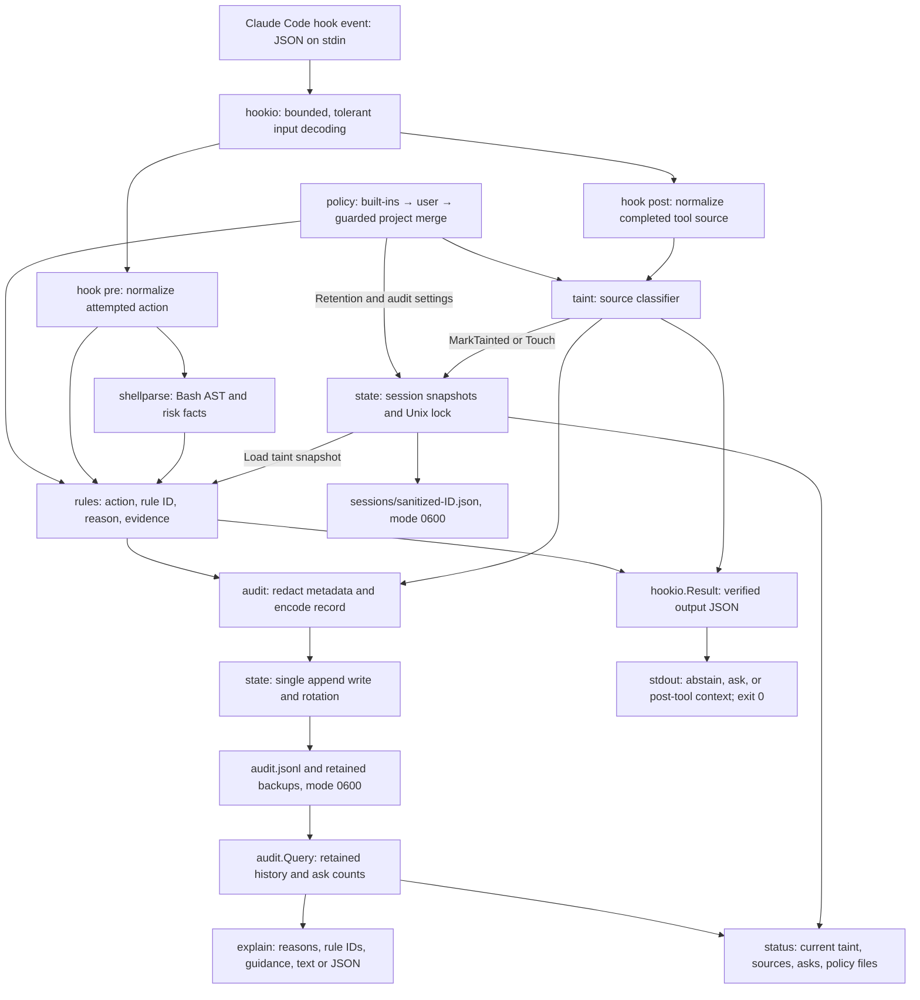

# Architecture

Taintwatch tracks untrusted sources after tools run and checks subsequent tool
requests against session taint and built-in action rules. Each hook invocation is
a separate, bounded command-line process. No network or model call runs inside a
hook. The root module's parser dependency is `mvdan.cc/sh/v3/syntax`.

Only `internal/hookio` knows Claude Code's hook input/output JSON contract.
Transport is limited to 8 MiB, unknown fields are tolerated, and tool results
remain opaque. In particular, WebFetch provenance does not depend on a guessed
response-body schema. Real capture confirmation remains pending in
[ASSUMPTIONS.md](ASSUMPTIONS.md); the spike is an independent throwaway module.

PreToolUse loads current state, derives shell facts for Bash, and evaluates the
ordered Go rule table. Clean benign decisions emit `{}` so Claude Code's normal
permissions still apply. Built-in risk matches ask, including always-on
self-protection and decode-and-run rules. No default rule denies. Reasons name
the taint source and attempted risk. See [RULES.md](RULES.md).

PostToolUse classifies WebFetch/WebSearch, MCP, shell readers, and selected file
reads. It records a taint event or touches the existing session, persists an audit
observation, and may add factual untrusted-data context. Touch does not clear
earlier taint. The completed tool call cannot be blocked retroactively. See
[TAINT.md](TAINT.md).

The state home is selected through `TAINTWATCH_HOME`, then XDG state paths. Managed
directories are 0700, session files use temp-file-plus-rename publication, and a
bounded Unix advisory lock coordinates processes. Audit records are redacted
before one append write; rotation defaults to 10 MiB with three backups. State
and audit updates are separate operations. Inspection reads bounded audit
snapshots outside the writer lock and never refreshes session expiry. See
[STATE.md](STATE.md) and [AUDIT.md](AUDIT.md).

Open is the default error mode. Closed pre-hook errors ask; closed post-hook
errors add advisory context. Input/storage/output failures can prevent durable
audit records. A worker deadline and final process watchdog bound stalls; a
broken transport cannot reliably deliver an ask. Shell analysis is best-effort,
and session-level taint loses fine-grained provenance. These are defense-in-depth
checks, not a solution to prompt injection. See [LIMITATIONS.md](LIMITATIONS.md).

`policy` strictly validates YAML and merges built-in, user and nearest-project
settings. A project cannot grant itself permission to loosen protections; ignored
changes are reported and invalid project YAML retains the last valid policy.
Hooks, status and explain use the loaded configuration. `policy show` annotates
each value with its origin. See [policy.md](policy.md).

Approval reuse, a clear-taint CLI, detectors/value matching, and installation
remain later work. Prompt and session-start hook handlers are stubs.

## M1 executable scenario

`TestBinarySessionFlow` builds the real binary and sends hook JSON over stdin in
isolated subprocesses with a temporary `TAINTWATCH_HOME`. It verifies clean secret
read → WebFetch taint → secret-read ask → secret-read/egress ask → benign command
allow → explain with matching rule IDs and reasons. The combined pipeline matches
TW001 first; rule precedence is intentional. Status assertions verify persisted
taint, and audit assertions verify both asks were recorded. This test runs with
`make test` on Linux/macOS; native Windows storage is unsupported.

For a recording, run `bash scripts/demo.sh` from any working directory. It builds
the executable, displays the same checks and reasons, then prints explain/status.
Requests use fixture data; the displayed shell commands are hook inputs. The
temporary project, fake `.env`, binary and state are removed on exit. Bash, Go
1.22+ and standard Unix utilities are sufficient; jq/Python are not required.
For WSL without a Go SDK, an absolute `TAINTWATCH_DEMO_BINARY` may point to a
fresh cross-compiled Linux executable. The subprocess test similarly accepts
`TAINTWATCH_E2E_BINARY` for that verification setup; normal CI compiles afresh.
